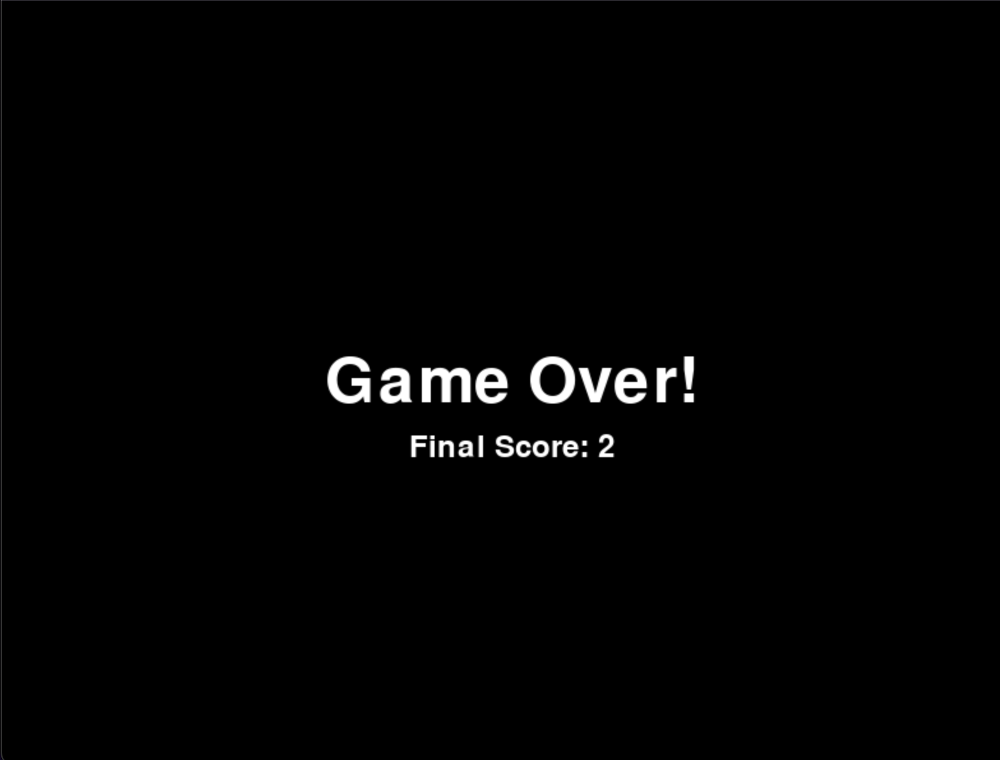

# ICS3U-Pygame-CPT

# Astral Avoidance

## Description
Astral Avoidance is a simple yet addicting game made with Pygame. The player controls an astronaut lost in space that is getting attacked by falling spaceships! 

## Objective
The main goal of the game is to achieve the highest score by avoiding the spaceships! As time progresses, more spaceships spawn which increases the challenge!

## Gameplay Mechanics
- **Player Controls:** Use the left and right arrow keys to move the astronaut horizontally.
- **Avoid Spaceships:** Spaceships descend from the top of the screen, and the player must navigate the astronaut to avoid collisions.
- **Scoring:** The score increases over time, with each second survived adding to the player's score.
- **Game Over:** If the astronaut collides with any spaceship, the game ends, displaying the final score.

## Scoring
- The score increases by the second based on how long the player has survived without colliding with the spaceship. 
- The final score is displayed once the game is over, showing how many seconds the player successfully survived.

## Limitations
- Currently, the game does not have sound effects or music.
- There is no high-score tracking between game sessions; the score resets every time the game restarts.
- The astronaut sprite does not animate 

## Screenshots

*Figure 1: Title screen where players start the game by pressing SPACE.*

 
*Figure 2: Game over screen displaying the final score.*

